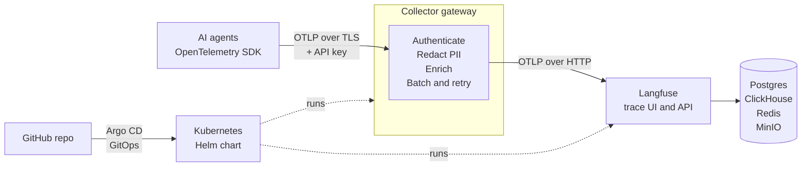

<div align="center">

# Enterprise AI Observability Platform

**A secure, open-source flight recorder for AI agents.**
See every step an agent takes, find where it failed, and keep private data out of storage.

[](https://github.com/praneeth-hari/AI-Observability-Platform/actions/workflows/ci.yml)


-lightgrey)

</div>

---

## The problem

Companies now run AI agents (assistants that plan, call an LLM, use tools and hand off to other agents). When one fails, is slow, burns tokens or answers wrongly, teams have to piece the story together from several systems by hand. Prompts and tool payloads may also contain **sensitive data** that must never be stored.

## What this platform does

Agents send **OpenTelemetry traces** to a **collector gateway**. The gateway authenticates the sender, removes sensitive data, adds standard metadata, and forwards the result to **Langfuse**, where every agent run is a browsable tree of LLM calls and tool calls with timing, errors and token counts.



### Highlights

| Area | What you get |
|---|---|
| **Tracing** | Parent/child spans for agent runs, LLM calls and tool calls, with latency, errors and token counts, searchable by trace ID |
| **Privacy first** | PII is redacted **before** anything is stored: emails, phone numbers, card numbers, SSNs, API keys, bearer tokens, medical record numbers, and fields named like secrets. UI-only masking is not relied on |
| **Secure by default** | API-key authentication, TLS 1.2+, no default passwords (the stack refuses to start without strong secrets), non-root read-only collector, network policies |
| **Reliable** | Batching, retry with back-off, memory limiter, tested against malformed payloads, backend outages and collector restarts |
| **Data lifecycle** | Automatic retention (ClickHouse TTL + object-store expiry) and a backup and restore tool, with a restore drill that was actually run |
| **Real agent** | A LangGraph agent that decides which tools to call, running on a local LLM (Ollama), fully traced |
| **Cloud native** | One Helm chart for the whole platform, deployed and kept in sync by Argo CD (GitOps) |
| **Open source only** | OpenTelemetry, Langfuse (MIT), PostgreSQL, ClickHouse, Redis, MinIO, LangGraph, Ollama, Helm, Argo CD |

## Quick start (Docker Compose)

You need Docker Desktop (about 8 GB free RAM) and Python 3.11+. Ollama is optional; without it the agent uses a mock LLM and the trace path still works.

```bash
git clone https://github.com/praneeth-hari/AI-Observability-Platform.git
cd AI-Observability-Platform

python -m pip install cryptography
python scripts/make_certs.py                 # development CA + collector certificate  -> certs/
python scripts/secrets_tool.py generate      # strong random secrets -> .env.generated
mv .env.generated .env                       # Windows: ren .env.generated .env

docker compose up -d                         # first start takes 2-3 minutes
```

Open <http://localhost:3000> and log in as `admin@example.com` with the password in `.env` (`LANGFUSE_INIT_USER_PASSWORD`). Then send some traces:

```bash
cd agent
python -m venv .venv && source .venv/bin/activate      # Windows: .venv\Scripts\activate
pip install -r requirements.txt

python langgraph_agent.py --question "What time is it, and what is 12 * 7?"
python langgraph_agent.py --pii --mock                 # fake sensitive data: check it appears as [REDACTED_...]
python langgraph_agent.py --fail --mock                # a failing tool: see the red error span
```

The agent prints a **Trace ID**; open **Tracing** in Langfuse to see it. To use a real local model, install [Ollama](https://ollama.com), run `ollama pull llama3.1:8b`, and set `OLLAMA_MODEL=llama3.1:8b` in `.env`.

## Run on Kubernetes (local test cluster)

Needs `kubectl`, `helm` and `kind`. Stop the Compose stack first (same ports).

```bash
kind create cluster --name ai-obs --config deploy/kind/kind-config.yaml
kubectl create namespace ai-obs
python scripts/k8s_secrets.py --namespace ai-obs | kubectl apply -f -     # secrets from .env, never stored in Git
helm install ai-observability deploy/helm/ai-observability -n ai-obs -f deploy/helm/ai-observability/values-kind.yaml

kubectl port-forward -n ai-obs svc/ai-observability-langfuse-web 3000:3000     # UI
kubectl port-forward -n ai-obs svc/ai-observability-collector 4318:4318        # agents
```

**GitOps with Argo CD:** after installing Argo CD, `kubectl apply -f deploy/argocd/application.yaml` makes GitHub the only control panel. Push a chart change and the cluster follows; change the cluster by hand and Argo CD reverts it. Details are in [docs/STEPS.md](docs/STEPS.md).

## Security and privacy controls

| Control | How it is enforced | Proven by |
|---|---|---|
| Redaction before storage | OTTL rules in the collector (values, secret-named keys, errors, stack traces, resource attributes) | 22 redaction tests using synthetic sensitive data |
| Caller authentication | Bearer API key on both OTLP receivers; wrong key gets 401 and nothing is stored | auth tests |
| Encryption in transit | TLS 1.2+ on the collector; plain HTTP and untrusted certificates are refused | TLS tests |
| No weak secrets | `${VAR:?}` in Compose and a required Kubernetes Secret; a tool audits and generates strong secrets | secrets tests, repo scan for committed keys |
| Retention | ClickHouse TTL on all trace tables, verified on a real ClickHouse engine | retention tests |
| Backup and recovery | Checksummed cold backups; restore needs an intact backup, matching secrets and `--yes` | backup tests and a live restore drill |
| Least privilege on Kubernetes | Collector runs non-root with a read-only filesystem; databases reachable only from Langfuse | chart tests |

## Quality: 150 automated tests

Every push runs the full suite in GitHub Actions against a **real OpenTelemetry Collector**, with a fake Langfuse backend that records exactly what would be stored.

```bash
pip install -r tests/requirements.txt chdb
python -m pytest        # needs Docker (or OTELCOL_BIN) and helm on PATH; takes about 4 minutes
```

Tests cover redaction, authentication, TLS, pipeline reliability, secrets handling, retention (including real deletion in an embedded ClickHouse), backup and restore, the LangGraph agent, the Helm chart and the Argo CD application.

## Built with AI assistance

This project was built through **human-directed AI pair-programming with Claude (Anthropic)**. The product requirements, scope, architecture decisions and acceptance of each step are human decisions (for example: Langfuse instead of Arize Phoenix for a fully open-source stack, and local LLMs instead of paid APIs). Claude drafted code, tests and documentation.

AI-written code is treated like any contributor's code: nothing is trusted until a test or a real run proves it. Every step was executed on a real machine, and the tests are checked to be able to fail (deliberately breaking the code and confirming the tests notice). Real problems surfaced this way, and were fixed with a regression test each:

- The redaction rule for secret-named fields silently deleted the LLM **token counts**, which would have broken cost reporting.
- Langfuse was unreachable through `kubectl port-forward` until its web server was told to listen on all interfaces.
- Langfuse crashed with an out-of-memory error under a small container limit; heap sizes are now set explicitly and tested.
- A parser that rejected a model reply containing two JSON objects made a small LLM look as if it could not use tools.

## Roadmap

| Step | Scope | Status |
|---|---|---|
| 1 | Local stack and sample agent | done |
| 2 | Real agent (LangGraph + local LLM) | done |
| 3 | PII redaction at the gateway | done |
| 4 | Automated tests and CI | done |
| 5 | Security basics: API key, TLS, secrets, retention, backups | done |
| 6 | Kubernetes and Helm | done |
| 7 | GitOps with Argo CD, CI/CD | in progress |
| 8 | SSO/RBAC, cert-manager, secrets vault, monitoring and alerts | planned |
| 9 | Onboarding Databricks agents, documentation | planned |
| 10 | Cost and quality dashboards, load test, runbook, handover | planned |

## Known limitations

Stated plainly, so nobody is surprised:

- **Prototype scale.** Databases run as single instances; high availability, multi-region and managed databases are not covered yet.
- **Development certificates.** The TLS certificate comes from a private dev CA; cert-manager or a company CA is planned (Step 8).
- **In-memory queue.** Spans waiting in the collector's queue are lost if the collector is killed mid-send.
- **MinIO image is not pinned** (Chainguard publishes only `latest`); pin by digest before production.
- **Backups pause ingestion** for about a minute and do not include `.env`.
- **Databricks onboarding** (Step 9) is not done yet.

## Repository layout

```
agent/                         Sample agent (agent.py) and LangGraph agent (langgraph_agent.py)
collector/config.yaml          Collector pipeline: auth, TLS, redaction, batching, export
docker-compose.yml             Local stack: collector + Langfuse + Postgres, ClickHouse, Redis, MinIO
deploy/helm/ai-observability/  Helm chart for Kubernetes
deploy/argocd/                 Argo CD application (GitOps)
deploy/kind/                   Local Kubernetes test cluster config
scripts/                       make_certs, secrets_tool, retention, backup, k8s_secrets
tests/                         150 automated tests
docs/STEPS.md                  Detailed build log for every step
```

## Documentation

- [docs/STEPS.md](docs/STEPS.md): step-by-step build log with commands and expected results.
- The product concept (problem, approach, MVP acceptance criteria) is in the *Enterprise AI Observability Product Prototype* document this project implements.
